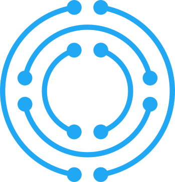
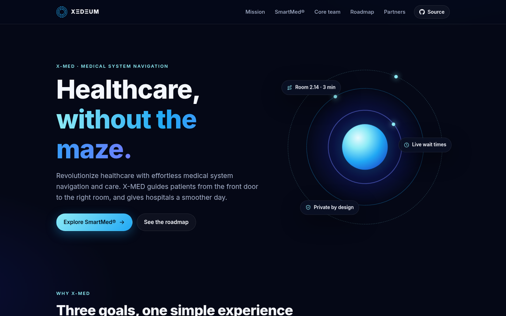
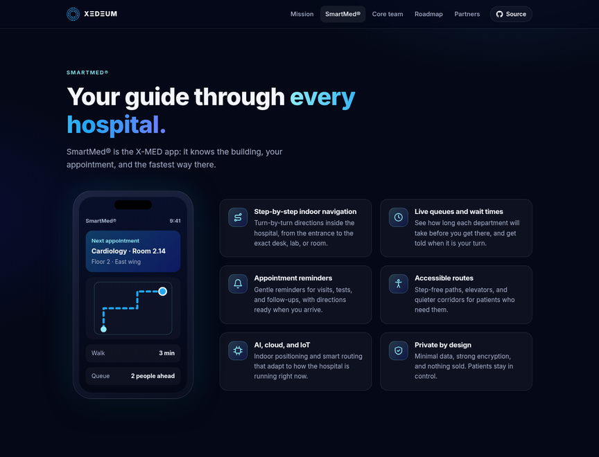
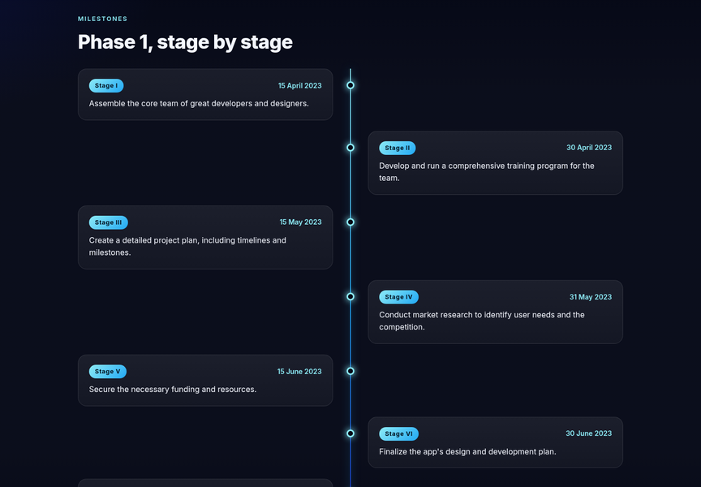
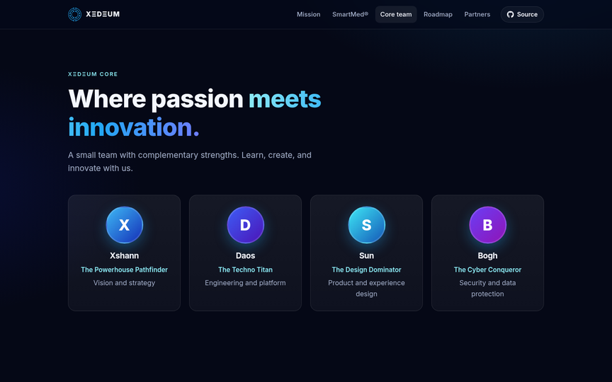
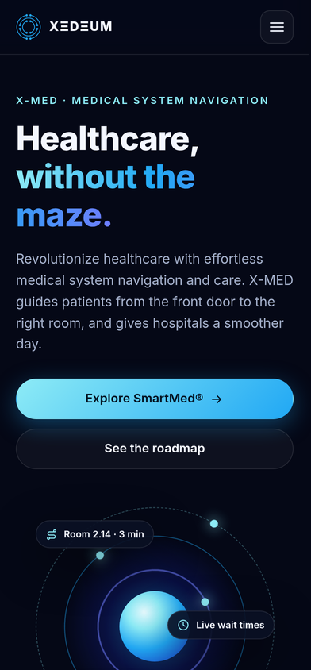

<div align="center">



# XΞDΞUM · X-MED Landing

**A landing site for X-MED, a concept app that helps patients find their way through hospitals and medical systems.**

[](https://cosminbmemetea.github.io/x-med-landing/)

**▶ Live demo: https://cosminbmemetea.github.io/x-med-landing/**

<a href="https://cosminbmemetea.github.io/x-med-landing/"></a>

</div>

## Pages

| Page | What's there |
| --- | --- |
| [Home](https://cosminbmemetea.github.io/x-med-landing/) | Hero with an animated CSS orb, the three goals, how it works, and a partner call to action |
| [Mission](https://cosminbmemetea.github.io/x-med-landing/mission/) | The three goals in detail: patient experience, hospital efficiency, trust and security |
| [SmartMed®](https://cosminbmemetea.github.io/x-med-landing/smartmed/) | The app concept, with a CSS phone mockup and an animated route |
| [Core team](https://cosminbmemetea.github.io/x-med-landing/core/) | The team as initials avatars (no photos) |
| [Roadmap](https://cosminbmemetea.github.io/x-med-landing/roadmap/) | Three phases over 24 months plus a milestone timeline |
| [Partners](https://cosminbmemetea.github.io/x-med-landing/partners/) | Who we partner with and how to get in touch |

<p align="center">
  
  
</p>
<p align="center">
  
  
</p>

## Design

- Dark, high-contrast theme with the brand palette: near-black `#050816`, white, and cyan/blue accents `#8DEBF6`, `#21A8F4`, `#192ABF`
- Inter, self-hosted at build time through `next/font`
- Sticky blurred navigation with a mobile menu, consistent pill buttons, and hover and focus states on every interactive element
- Subtle entrance and ambient animations, all turned off for `prefers-reduced-motion`
- Responsive from 320 px phones to wide desktops; Open Graph and Twitter cards (`public/og.png`) for nice link previews

## Tech stack

| Layer | Tools |
| --- | --- |
| Framework | [Next.js 14](https://nextjs.org) (Pages Router), static export |
| UI | React 18, hand-written CSS (no UI library), inline SVG icons |
| Fonts | Inter via `next/font` (self-hosted at build time, no Google requests from visitors) |
| Language | TypeScript |
| Hosting | GitHub Pages via GitHub Actions |

## Run locally

Requires Node.js 18.17 or newer.

```bash
git clone https://github.com/CosminBMemetea/x-med-landing.git
cd x-med-landing
npm ci
npm run dev        # http://localhost:3000
```

Static production build (written to `out/`):

```bash
npm run build
npx serve out      # or any static file server
```

## Deployment

The demo is served by GitHub Pages from the `gh-pages` branch, which holds the static export. Build it with the Pages sub-path so links and images resolve, then publish `out/`:

```bash
NEXT_PUBLIC_BASE_PATH=/x-med-landing npm run build
touch out/.nojekyll
npx gh-pages -d out --dotfiles
```

## Privacy & security

- **No personal data is collected or stored.** The site is fully static: no forms, accounts, cookies, `localStorage`, analytics, or tracking pixels.
- **No server or API routes.** Nothing a visitor does is sent anywhere.
- **No third-party requests at runtime.** Fonts, icons, and images are served from the same origin.
- **No photos of real people.** The team is shown with initials avatars.
- Outbound referrers are suppressed (`referrer: no-referrer`).
- Secrets are never committed (`.env*` is git-ignored). See [SECURITY.md](SECURITY.md) to report a vulnerability.

## Roadmap (concept)

1. **Pre-development:** assemble the team, research user needs, plan milestones, secure funding.
2. **Development:** build indoor navigation for hospitals, test for reliability and security, partner with healthcare institutions.
3. **Launch and growth:** public launch, iterate on feedback, expand to more institutions.
